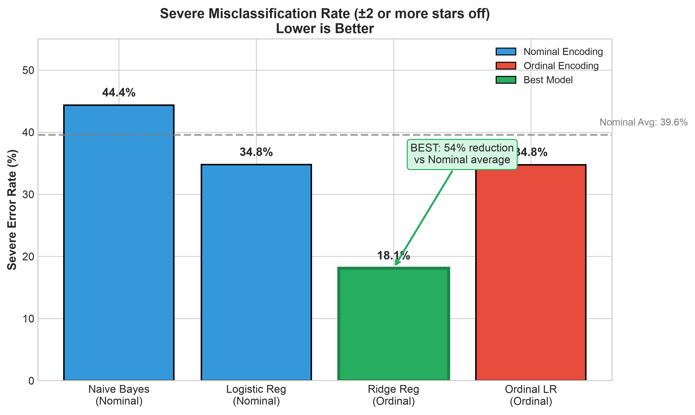
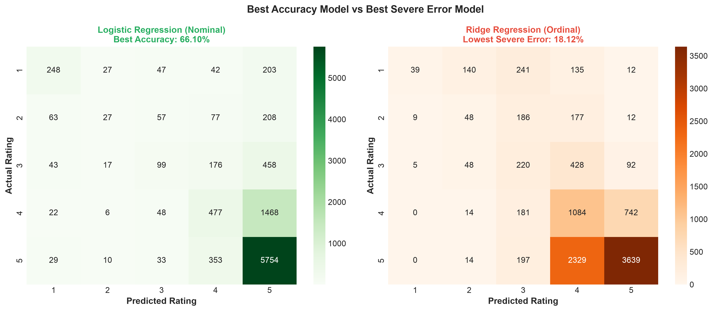
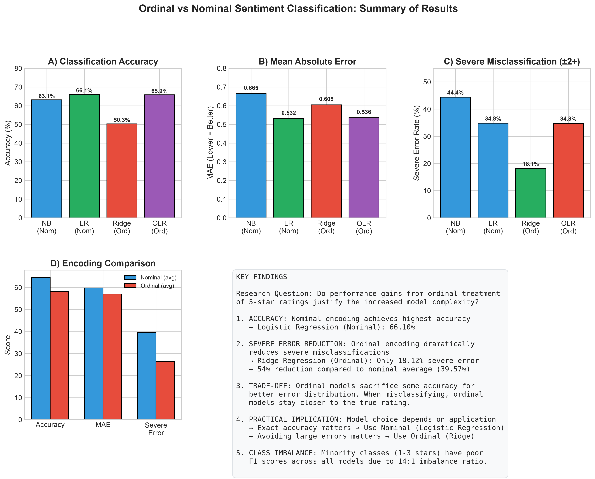

# Ordinal vs Nominal Sentiment Classification

A comparison of ordinal and nominal classifiers for 5-star Amazon review
prediction. Tests whether treating ratings as ordered values (1 < 2 < … < 5)
reduces severe-error rates relative to standard multiclass classification.

**Authors:** three students, as a team project for CS 5100 (Foundations of
AI, Northeastern University). Atharv Chaudhary's part was the preprocessing,
the TF-IDF features (word counts weighted down for words that appear in many
reviews), the Ridge Regression model and the visualizations.

## Key finding

When a 1-star review is misclassified, the *type* of error matters. Predicting
it as 2 stars is much less wrong than predicting 5 stars. The ordinal models
exploit this directly.

- Best top-line accuracy: **Logistic Regression (Nominal)** at 66.10%, MAE 0.5315.
- Best severe-error rate: **Ridge Regression (Ordinal)**. Only 18.1% of its
  wrong predictions are off by 2 or more stars, roughly half the share for the
  nominal classifiers (35% to 44%), at the cost of about 16 accuracy points.
  Counted over all 9,992 test reviews, the gap is smaller: 9.0% of Ridge's
  predictions are off by 2 or more stars, against 11.8% for Logistic
  Regression and 16.4% for Naive Bayes.

Ridge, the ordinal regression model, trades raw accuracy for substantially
safer mistakes; Ordinal Logistic Regression's share (34.8%) is the same as
Logistic Regression's.



## Dataset

Stanford SNAP **Amazon Reviews — Electronics 5-core**
(`reviews_Electronics_5.json.gz`).

- ~1.69M reviews of electronics products, June 1999 to July 2014
- 5-core: each user has at least 5 reviews and each item has at least 5 reviews
- Source: http://snap.stanford.edu/data/amazon/productGraph/categoryFiles/

The pipeline reads the first 50,000 records (`SAMPLE_SIZE = 50000` in
`1_Data_Loading.ipynb`), reduces to `(text, rating)`, drops reviews shorter
than 10 characters or with rating outside [1, 5], and saves the cleaned set
of 49,960 reviews to `data/amazon_electronics_cleaned.csv`.

These are Amazon product reviews (Electronics, 5-core) collected by Julian
McAuley's lab at UC San Diego (UCSD) and shared through Stanford SNAP.
Notebook 1 downloads them from
http://snap.stanford.edu/data/amazon/productGraph/categoryFiles/reviews_Electronics_5.json.gz.
If you use the data, follow the dataset's citation and usage terms.

## Models

Four shallow classifiers on TF-IDF features.

Nominal (ratings treated as unordered classes):
- Multinomial Naive Bayes
- Multinomial Logistic Regression

Ordinal (ratings treated as ordered values):
- Ridge Regression with rounded-integer prediction
- Ordinal Logistic Regression with cumulative-probability thresholds

## Results

| Model | Encoding | Accuracy | MAE | F1 Macro | Severe Error |
|---|---|---:|---:|---:|---:|
| Naive Bayes | Nominal | 63.14% | 0.6646 | 0.2322 | 44.4% |
| Logistic Regression | Nominal | **66.10%** | **0.5315** | 0.3816 | 34.8% |
| Ridge Regression | Ordinal | 50.34% | 0.6051 | 0.3077 | **18.1%** |
| Ordinal Logistic Regression | Ordinal | 65.85% | 0.5359 | 0.3713 | 34.8% |

Severe error = the share of a model's wrong predictions that are off by 2 or
more stars, computed as `(error_distances >= 2).sum() / errors.sum()` in
notebooks 3 and 4. As a share of all 9,992 test reviews instead, severe errors
are 16.4% for Naive Bayes, 11.8% for Logistic Regression, 9.0% for Ridge
Regression and 11.9% for Ordinal Logistic Regression.





## Run

The notebooks were last run with Python 3.13.

```bash
pip install -r requirements.txt
```


Then execute the notebooks in order:

1. `notebooks/1_Data_Loading.ipynb` — fetch and clean the dataset
2. `notebooks/2_EDA_Visualization.ipynb`
3. `notebooks/3_Models_Nominal.ipynb`
4. `notebooks/4_Models_Ordinal.ipynb`
5. `notebooks/5_Results_Analysis.ipynb`
6. `notebooks/6_Additional_Visualizations.ipynb`

Notebook 1 downloads the whole raw file, about 496 MB, over plain http (not
https) to `data/electronics.json.gz`, then uses only its first 50,000 reviews.
It skips the download if that file is already there. A good download is
495,854,086 bytes and has this SHA-256 hash (a fingerprint of the file's
contents):

```bash
shasum -a 256 data/electronics.json.gz
# af3e7686df7ba4d1ea617197cc5e236c761367e86626c7d9246ac2fc79e36358
```

Re-running notebooks 2 to 6 overwrites the tracked files in `results/`. With
current library versions the regenerated tables differ slightly from the
committed ones: for example, Logistic Regression MAE comes out as 0.5318
instead of 0.5315, and Ridge accuracy as 50.35% instead of 50.34%. The numbers
in this README come from the committed `results/tables/*.csv`.

## Project structure


```
.
├── notebooks/
│   ├── 1_Data_Loading.ipynb
│   ├── 2_EDA_Visualization.ipynb
│   ├── 3_Models_Nominal.ipynb
│   ├── 4_Models_Ordinal.ipynb
│   ├── 5_Results_Analysis.ipynb
│   ├── 6_Additional_Visualizations.ipynb
│   └── archive/                  # early prototypes, not part of the pipeline (see Notes)
├── results/
│   ├── figures/                  # PNG figures
│   └── tables/                   # CSV summaries
├── data/                         # populated by notebook 1
├── requirements.txt
├── LICENSE
└── README.md
```


## Notes

This was a CS 5100 final project. `notebooks/archive/` keeps four early
prototypes that are not part of the pipeline. One of them,
`SVM_and_Deep_Learning_exploration.ipynb`, sketches a linear SVM (support
vector machine, a classifier that splits the classes with flat boundaries) and
a BiLSTM (a neural network that reads each review in both directions), but it
has no saved outputs and its comparison table holds placeholder numbers, so it
gives no result for either model. The other three are early Naive Bayes and
Logistic Regression runs on 10,000 reviews (`PRELIMINARY_RESULTS.ipynb`,
`tp.ipynb`) and an unfinished look at the Amazon-Reviews-2023 data
(`electronics_visualization.ipynb`). Between them, the archive notebooks need
tensorflow, kagglehub and kaggle (none of which `requirements.txt` lists),
Kaggle credentials, a Colab-only file path, or multi-GB downloads. An attempt
to swap the dataset for the more recent McAuley-Lab Amazon-Reviews-2023
release was prototyped but not integrated; the canonical pipeline runs on the
older SNAP 5-core data.

## License

MIT.
